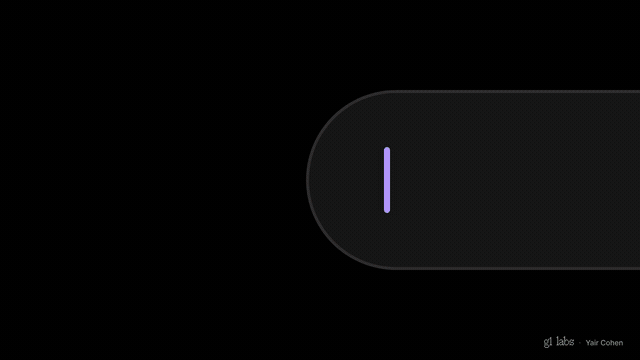

# Gen UI by G1 Labs

The designed component layer for generative UI: copy-paste components an AI agent assembles at runtime from real data. Each component ships with a Zod schema the agent fills in, guidance, a tool definition and a typed result. Install with the shadcn CLI and own the code.

[](.github/assets/reel.mp4)



**Try it live:** type a request in the [playground](https://gen-ui-kit.vercel.app/playground) and an agent builds it from the catalog.

Docs, live demos and install commands: https://gen-ui-kit.vercel.app

## How it works


Each component's Zod schema is used three times: it builds the agent's prompt and tools, it validates the agent's call, and it types the component. At runtime the adapters turn the agent's tool calls into one shape, the Renderer shows each call in its lifecycle state, and the user's action goes back to the agent as a tool result.

## What's here

| Path | Holds |
| --- | --- |
| `registry/genui/<name>/` | One folder per component: `<name>.tsx`, `<name>.schema.ts` (schema, guidance, tool), optional utils and `__tests__/` |
| `registry/genui/renderer/` | The Renderer (lifecycle states, layouts, binds), the prompt and tool builder, validation, and adapters for the AI SDK, AG-UI, LangGraph, OpenUI, json-render and A2UI |
| `src/components/genui/` | Shared primitives every component uses (`Surface`, type and motion roles, series colours, date picker, locale) |
| `src/components/ui/`, `src/components/animate-ui/` | The shadcn and Animate UI parts the components build on |
| `registry.json` | The registry items, including the optional `genui-theme` |

## Develop

```bash
pnpm install
pnpm typecheck
pnpm test
pnpm registry:build   # writes public/r/*.json
```

See [CONTRIBUTING.md](CONTRIBUTING.md) before opening a pull request.

## License

[MIT](LICENSE) © 2026 G1 Labs. Code copied from other projects is listed in [THIRD_PARTY_NOTICES.md](THIRD_PARTY_NOTICES.md).
